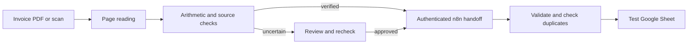

# Synq Paperwork Robot

An invoice can look right and still contain a wrong quantity, price or total. This local prototype reads invoice PDFs and scans, checks the extracted fields against arithmetic and source evidence, and sends uncertain lines to a review screen before they can be saved to Google Sheets.

I built this with AI coding agents as a Synq Logic portfolio project. I defined the workflow, directed the build and checked the results. **This is a single-user local prototype, with evidence from synthetic invoices.**

**Recorded result:** on September 27, 2026, it matched **3,844 of 3,875 expected lines on nine synthetic invoices (99.2%)**. All 31 incorrect lines were flagged for review. That describes this small test set, not an accuracy guarantee for real invoices.

**Start here:** [case study](docs/case-study.md) · [evaluation and the difficult scan](docs/evaluation.md) · [offline quickstart](#run-the-offline-checks)

Bosko Tutnjilovic · AI Automation Engineer · [Synq Logic](https://synqlogic.com)

## What happens to an invoice

1. The pipeline reads pages and extracts invoice fields and line items. Scanned pages can go through additional readers and a referee.
2. Plain-code checks compare line arithmetic, invoice totals and PDF text positions. Failing pages can be reread within a fixed limit.
3. A verified invoice goes to the configured Sheets handoff automatically. An uncertain invoice opens a review path with page images beside editable fields.
4. A person corrects and rechecks the fields, or explicitly approves an exception. The sender accepts only verified or approved records.
5. The n8n workflow validates again, checks for duplicates and writes raw values to the intended Sheet.

“Verified” means these checks passed. It is not a financial audit or proof that every possible error has been found.



## The useful failure case

The recorded evaluation covers two layouts, digital and scanned variants, and documents of 1, 5 and 30 pages. Eight of nine invoices were verified automatically. The difficult 30-page scan contained 31 incorrect extracted lines; all were flagged. Two correct lines were also flagged.

No incorrect line escaped a flag on this set. That observation does not establish a zero-error rate on new layouts, phone photos, other languages or real customer documents. The [evaluation summary](docs/evaluation.md) gives the per-invoice results and the public fixtures have answer keys.

The [case study](docs/case-study.md) explains the assumed business scenario, acceptance criteria, design decisions, recorded latency and remaining limits. There is no customer deployment or measured client time-saving result.

## Run the offline checks

Requires Python 3.12+ and [uv](https://docs.astral.sh/uv/).

```bash
git clone https://github.com/skabo42000/synq-paperwork-robot.git
cd synq-paperwork-robot
uv sync --locked
uv run pytest -q
```

The tests use fake readers and a fake Sheets sender. They need no credentials and make no model or Sheets calls. Dependency installation needs package access. The project card records 99 offline tests passing on October 22, 2026; that is a dated result, not a fresh test run of your clone.

For a short review without installing anything, read the [nine-invoice result table](docs/evaluation.md), then the save/review tests in [tests/](tests/).

## Save failures need a clear state

A timeout does not prove that a remote write failed. The local app records that saving has started before making the request. It blocks concurrent approvals of the same upload and validates the successful acknowledgment.

An interrupted or ambiguous write becomes **save unknown**. The app refuses automatic retry or deletion of that upload until the Sheet result has been reconciled. Uploading the document again is not a safe recovery procedure.

These controls protect a single local process and upload. The Sheets duplicate check is read-then-append, not a transaction. Concurrent executions or partial writes still require durable remote idempotency and reconciliation before production use.

## Run the portal with your own test integrations

This path makes external model calls and can write to a Sheet. Start with the synthetic fixtures and an account and test Sheet you control.

1. Copy `.env.example` to `.env`.
2. Set a random `PORTAL_PASSWORD` of at least 12 characters.
3. Set your own Gemini key. `GOOGLE_API_KEY_DEV` takes precedence when supplied.
4. Follow [n8n/README.md](n8n/README.md) to configure the authenticated handoff and the exact headers in a test Sheet. The supplied export is inactive and has account bindings removed.

Leave the webhook blank if you want no Sheets writes; a verified invoice will report a save failure. Extraction still sends document content to the configured model provider and may cost money.

```bash
uv run uvicorn synq_paperwork.app:app --host 127.0.0.1 --port 8000
```

Open `http://127.0.0.1:8000` and upload a fixture from `testdata/invoices/`. Compare extracted fields with the original page. For **needs review**, correct flagged fields, recheck and approve only after checking the source. Verified invoices are sent automatically when the webhook is configured.

Optional provider-based evaluation, beginning with a one-page fixture:

```bash
uv run python -m synq_paperwork.evals checked 1p
```

This command calls the model provider. It is separate from the offline tests.

## Where to inspect the design

| Path | What to look for |
| --- | --- |
| `src/synq_paperwork/pipeline.py` | LangGraph extraction and verification flow |
| `src/synq_paperwork/checks.py`, `columns.py`, `crosscheck.py` | Arithmetic, column interpretation and reader comparisons |
| `src/synq_paperwork/app.py`, `jobs.py`, `static/` | Portal, review, local queue and save states; filenames share the package prefix |
| `src/synq_paperwork/sheets.py` | Sender gate and acknowledgment validation |
| `n8n/` | Inactive Sheets handoff template and integration contract |
| `testdata/`, `tests/` | Synthetic invoices, answer keys and offline failure cases |

The project uses Python, LangGraph, Gemini, PyMuPDF, FastAPI, n8n and Google Sheets.

## Limits and data handling

The portal uses one shared password and a local queue. Uploads remain on local disk; ignored folders are not encrypted storage. There is no tenant isolation or established production operating model. Public use would need stronger access control, shared spending limits, retention rules, encryption, monitoring and reliable remote-write recovery.

Read [SECURITY.md](SECURITY.md) before adding real documents. Use synthetic data while evaluating the project.

There is no hosted demo recorded for this prototype. Code reuse terms have not been established in this review; the supplied repository listing contains no project LICENSE file. Setup and external integrations were not rerun for the October 25, 2026 documentation review.
